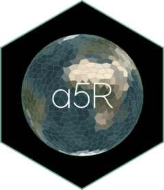

<!-- README.md is generated from README.Rmd. Please edit that file -->

```{r, include = FALSE}
knitr::opts_chunk$set(
  collapse = TRUE,
  comment = "#>",
  fig.path = "man/figures/README-",
  out.width = "100%"
)
set.seed(1)
```

# a5R <a href="https://belian-earth.github.io/a5R/"></a>

<!-- badges: start -->
[](https://github.com/belian-earth/a5R/actions/workflows/R-CMD-check.yaml)
[](https://app.codecov.io/gh/belian-earth/a5R)
[](https://extendr.rs/extendr/extendr_api/)
[](https://lifecycle.r-lib.org/articles/stages.html#stable)
[](https://www.apache.org/licenses/LICENSE-2.0)
[](https://github.com/belian-earth/a5R/issues)
[](https://CRAN.R-project.org/package=a5R)
<!-- badges: end -->

a5R provides R bindings for the [A5](https://a5geo.org/) pentagonal geospatial index, powered by the
[a5 Rust crate](https://github.com/felixpalmer/a5-rs) via
[extendr](https://extendr.rs/extendr/extendr_api/).

A5 partitions the Earth's surface into pentagonal cells across 31 resolution
levels. Cells are equal-area and encoded as 64-bit integers; at the finest
resolution each covers about 30 mm².

a5R 1.0 uses the A5 1.0 cell index, which numbers cells differently from
earlier versions. Convert ids stored by a5R 0.x with `a5_migrate()`.

## Installation

``` r
install.packages("a5R")
```

Or install the development version from GitHub:

``` r
# install.packages("pak")
pak::pak("belian-earth/a5R")
```

Building from source needs a [Rust toolchain](https://rustup.rs/) (`cargo` and
`rustc`).

## Quick example

```{r example, message = FALSE}
library(a5R)

# Index a point to a cell
cell <- a5_lonlat_to_cell(-3.19, 55.95, resolution = 10)
cell

# Get the boundary polygon
a5_cell_to_boundary(cell)

# Navigate the hierarchy
a5_cell_to_parent(cell)
a5_cell_to_children(cell)
```

Polygons become coverings, one per feature. Here North Carolina's counties
are filled with cells, coloured by their distance from Wake County's
centroid:

```{r nc-distance, fig.width = 9, fig.height = 4, dpi = 150, fig.alt = "North Carolina's counties filled with A5 cells at resolution 9, coloured from dark near Wake County to yellow at the far west of the state."}
nc <- sf::read_sf(system.file("shape/nc.shp", package = "sf"))
nc$a5 <- a5_polygon_to_cells(nc, resolution = 9, containment = "overlapping")

cells <- a5_uncompact(nc$a5)
wake <- sf::st_coordinates(sf::st_centroid(nc$geometry[nc$NAME == "Wake"]))
centre <- a5_lonlat_to_cell(wake[, 1], wake[, 2], resolution = 9)
dist <- a5_cell_distance(centre, cells, units = "km")

plot(a5_cell_to_boundary(cells), col = hcl.colors(50)[cut(as.numeric(dist), 50)], border = "grey50", lwd = 0.5)
plot(nc$geometry, border = "white", lwd = 0.5, add = TRUE)
```

See `vignette("a5R")` for a full walkthrough of indexing, boundaries,
hierarchy, traversal, and geometry-to-cell conversion.

## Features

- **Vectorised Rust core:** all operations implemented in Rust and called
  from R via extendr. A [benchmark suite](https://github.com/belian-earth/a5R/tree/main/benchmarks)
  mirroring the TypeScript, Python and Rust ports runs on every pull
  request and fails on regressions above 15%.
- **vctrs + wk integration:** cell indices use an `a5_cell` type with
  tibble support; geometries return as `wk_wkb`/`wk_wkt` vectors compatible
  with sf and terra.
- **Coverings:** polygons, disks and caps become `a5_covering` vectors,
  one compacted cell set per feature, that combine (`a5_union()`,
  `a5_intersect()`, `a5_difference()`), test (`a5_contains()`) and measure
  (`a5_area()`) without expanding to millions of cells. See
  `vignette("coverings")`.
- **Geometry indexing:** `a5_polygon_to_cells()` and
  `a5_line_string_to_cells()` map polygons and great-circle lines to cells.
- **Traversal:** `a5_grid_disk()` and `a5_spherical_cap()` select
  neighbours by hop count or great-circle distance.
- **Spatial hierarchy:** `a5_cell_to_supercell()` and
  `a5_cell_to_subcells()` move between resolutions by location, so
  aggregation counts each fine cell inside the coarse cell it lies in.
- **Arrow and Parquet:** cells and coverings convert to Arrow `uint64`
  columns and back exactly, with the A5 index recorded in the schema. See
  `vignette("arrow-parquet")`.
- **Multi-threading:** opt-in parallel processing via rayon for vectorised
  operations. See `vignette("multithreading")`.

## Acknowledgements

A5 was created by [Felix Palmer](https://github.com/felixpalmer). This package
is a thin R wrapper around his work and would not exist without it. The
[Query-farm](https://github.com/Query-farm/a5) team maintain the DuckDB A5
extension, which wraps the same Rust crate and provided a valuable reference
for this project.
