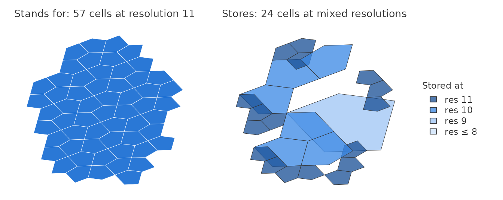
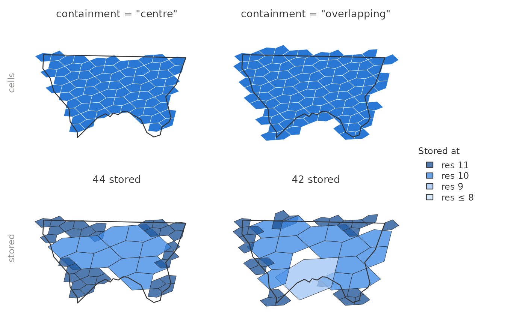
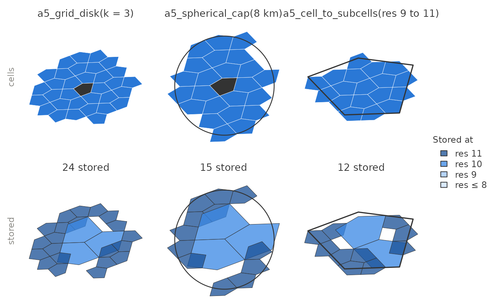
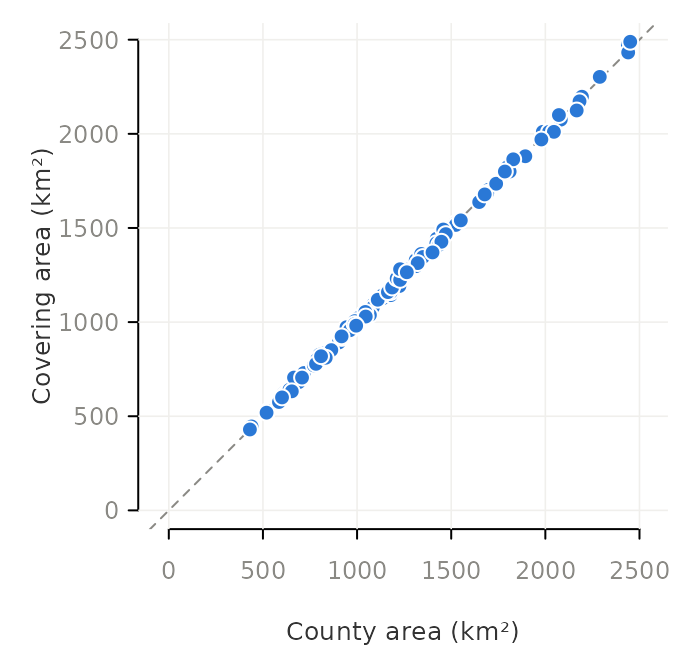
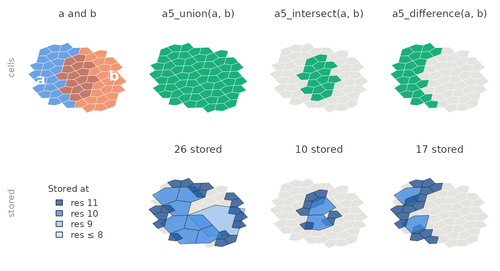
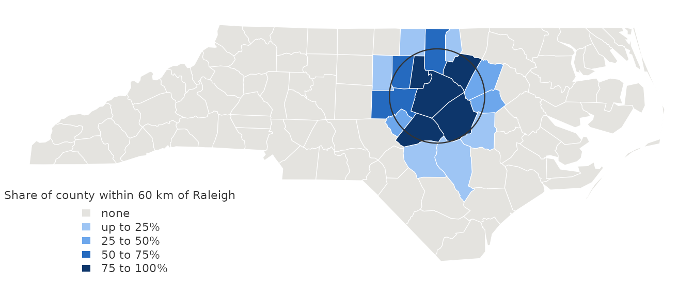
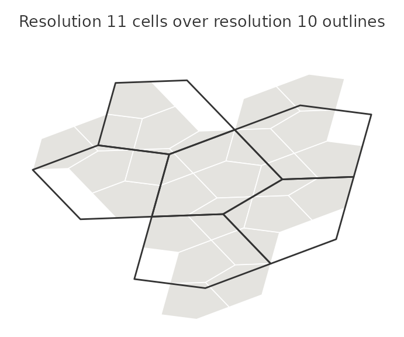
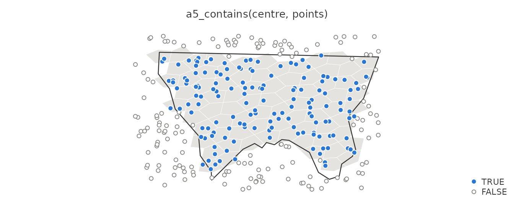
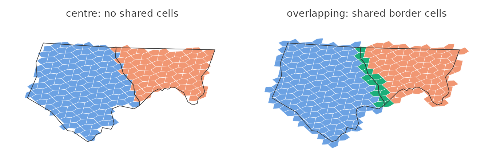

# Coverings: sets of cells

``` r

library(a5R)
library(sf)
```

A *covering* is a set of A5 cells at one resolution that stands for an
area: the cells of a polygon, of a disk around a cell, or of a cap of a
given radius. An `a5_covering` vector holds one covering per element, so
coverings sit in a data frame column next to the features they describe.

## What a covering stores

A covering is stored compacted: every complete group of sibling cells is
replaced by their parent, and a trailing *compaction marker* records the
resolution the stored cells stand for.

``` r

raleigh <- a5_lonlat_to_cell(-78.64, 35.78, resolution = 11)
cap <- a5_spherical_cap(raleigh, radius = 12000)
cap
#> <a5_covering[1]>
#> [1] res 11: 57 cells (24 stored)
```



The stored cells are parents in the A5 index, whose outlines do not
nest: drawn directly they overlap their neighbours and leave gaps.
Everything that combines, tests or measures coverings works on the
stored cells without expanding them, which keeps it fast for coverings
that stand for millions of cells. To draw a covering or join it to data
keyed by cell, expand it with
[`a5_uncompact()`](https://belian-earth.github.io/a5R/reference/a5_compaction.md),
as the figures here do. Where it helps, a second row shows what the same
covering stores, as
[`a5_covering_stored()`](https://belian-earth.github.io/a5R/reference/a5_covering_stored.md)
returns it.

## Building coverings

[`a5_polygon_to_cells()`](https://belian-earth.github.io/a5R/reference/a5_polygon_to_cells.md)
returns one covering per feature. By default a cell belongs when its
centre lies inside the polygon; `containment = "overlapping"` also takes
every cell the boundary touches, so the cells cover the polygon without
gaps. Polygon edges are great circles, as in the other A5 libraries;
[`a5_bbox()`](https://belian-earth.github.io/a5R/reference/a5_bbox.md)
gives the box those edges span.

``` r

nc <- st_read(system.file("shape/nc.shp", package = "sf"), quiet = TRUE)
nc <- st_transform(nc, 4326) # A5 works in WGS 84 longitude and latitude
alleghany <- nc[nc$NAME == "Alleghany", ]

centre <- a5_polygon_to_cells(alleghany, resolution = 11)
overlapping <- a5_polygon_to_cells(alleghany, resolution = 11, containment = "overlapping")
c(centre, overlapping)
#> <a5_covering[2]>
#> [1] res 11: 77 cells (44 stored)  res 11: 102 cells (42 stored)
```



The functions that start from a cell return one covering per centre
cell:
[`a5_grid_disk()`](https://belian-earth.github.io/a5R/reference/a5_grid_disk.md)
takes every cell within `k` edge steps
([`a5_grid_disk_vertex()`](https://belian-earth.github.io/a5R/reference/a5_grid_disk.md)
also steps across shared vertices),
[`a5_spherical_cap()`](https://belian-earth.github.io/a5R/reference/a5_spherical_cap.md)
every cell whose centre is within a distance, and
[`a5_cell_to_subcells()`](https://belian-earth.github.io/a5R/reference/a5_spatial_hierarchy.md)
the finer cells whose centres lie inside a coarser cell.

``` r

disk <- a5_grid_disk(raleigh, k = 3)
cap <- a5_spherical_cap(raleigh, radius = 8000)
coarse <- a5_cell_to_supercell(raleigh, resolution = 9)
subcells <- a5_cell_to_subcells(coarse, resolution = 11)
```



[`a5_compact()`](https://belian-earth.github.io/a5R/reference/a5_compaction.md)
turns any set of cells into a covering, and
[`as_a5_covering()`](https://belian-earth.github.io/a5R/reference/a5_covering.md)
builds coverings from cell lists or from the stored form written by
other A5 libraries.

## Measuring coverings

[`a5_count()`](https://belian-earth.github.io/a5R/reference/a5_covering_measures.md)
gives the number of cells a covering stands for, and
[`a5_area()`](https://belian-earth.github.io/a5R/reference/a5_covering_measures.md)
its area. A5 cells are equal-area, so the area is the count times the
area of one cell. At resolution 11, where a cell covers about 8 km², it
tracks each county’s true area closely:

``` r

nc$cells <- a5_polygon_to_cells(nc, resolution = 11)
nc$cell_area <- a5_area(nc$cells, units = "km^2")
head(nc[c("NAME", "cells", "cell_area")], 3)
#> Simple feature collection with 3 features and 3 fields
#> Geometry type: MULTIPOLYGON
#> Dimension:     XY
#> Bounding box:  xmin: -81.74091 ymin: 36.23397 xmax: -80.4351 ymax: 36.58973
#> Geodetic CRS:  WGS 84
#>        NAME                         cells        cell_area
#> 1      Ashe res 11: 139 cells (55 stored) 1126.9112 [km^2]
#> 2 Alleghany  res 11: 77 cells (44 stored)  624.2602 [km^2]
#> 3     Surry res 11: 176 cells (62 stored) 1426.8804 [km^2]
#>                         geometry
#> 1 MULTIPOLYGON (((-81.47258 3...
#> 2 MULTIPOLYGON (((-81.23971 3...
#> 3 MULTIPOLYGON (((-80.45614 3...
```



Each point is a county; the dashed line marks equal areas. The covering
area is within 1% of the county’s for the median county and about 6% at
worst, because each cell straddling a county boundary is in or out by
its centre. Finer resolutions reduce the error.

## Combining coverings

[`a5_union()`](https://belian-earth.github.io/a5R/reference/a5_set_operations.md),
[`a5_intersect()`](https://belian-earth.github.io/a5R/reference/a5_set_operations.md)
and
[`a5_difference()`](https://belian-earth.github.io/a5R/reference/a5_set_operations.md)
combine coverings without expanding them.

``` r

a <- a5_spherical_cap(a5_lonlat_to_cell(-78.72, 35.78, 11), radius = 10000)
b <- a5_spherical_cap(a5_lonlat_to_cell(-78.58, 35.78, 11), radius = 10000)
a5_union(a, b)
#> <a5_covering[1]>
#> [1] res 11: 62 cells (26 stored)
a5_intersect(a, b)
#> <a5_covering[1]>
#> [1] res 11: 16 cells (10 stored)
a5_difference(a, b)
#> <a5_covering[1]>
#> [1] res 11: 23 cells (17 stored)
```



The result of each operation is compacted again, so a covering that
comes out of a union stores its merged interior as coarser cells.

They work element by element, recycling a length-one argument, so one
call intersects every county with a single cap. With one argument,
[`a5_union()`](https://belian-earth.github.io/a5R/reference/a5_set_operations.md)
merges every covering in a vector into one.

``` r

near_raleigh <- a5_spherical_cap(raleigh, radius = 60000)
nc$share_near <- a5_count(a5_intersect(nc$cells, near_raleigh)) / a5_count(nc$cells)

state <- a5_union(nc$cells)
state
#> <a5_covering[1]>
#> [1] res 11: 15,672 cells (1,356 stored)
```



Both coverings in each pair must be at the same resolution, or it is an
error. A5 cells do not nest across resolutions: a resolution-11 cell can
straddle the edge between two resolution-10 cells. To move a covering to
a coarser resolution,
[`a5_covering_to_supercells()`](https://belian-earth.github.io/a5R/reference/a5_covering_to_supercells.md)
takes the coarse cells holding the centre of any of its cells (see
[`vignette("spatial-hierarchy")`](https://belian-earth.github.io/a5R/articles/spatial-hierarchy.md)).

``` r

cap10 <- a5_spherical_cap(a5_cell_to_supercell(raleigh), radius = 60000)
a5_union(state, cap10)
#> Error in `a5_union()`:
#> ! union failed for element 1: Cannot combine cells at resolution 11 with
#>   cells at resolution 10
a5_union(a5_covering_to_supercells(state, 10), cap10)
#> <a5_covering[1]>
#> [1] res 10: 4,096 cells (583 stored)
```



## Testing coverings

[`a5_contains()`](https://belian-earth.github.io/a5R/reference/a5_covering_predicates.md)
tests cells against a covering. Indexing points at the covering’s
resolution turns it into a point-in-polygon test, decided cell by cell:
a point counts as inside when its cell belongs to the covering.

``` r

set.seed(1)
lon <- stats::runif(300, -81.4, -80.9)
lat <- stats::runif(300, 36.35, 36.6)
points <- a5_lonlat_to_cell(lon, lat, resolution = 11)
inside <- a5_contains(centre, points)
table(inside)
#> inside
#> FALSE  TRUE 
#>   150   150
```



Near the county line the answer follows the cells, not the line: a point
just outside it is inside when its cell’s centre is in the county, and
the reverse.

[`a5_overlaps()`](https://belian-earth.github.io/a5R/reference/a5_covering_predicates.md)
tests whether two coverings share any cell. With centre containment
every cell belongs to the one county holding its centre, so neighbouring
counties never overlap. With `containment = "overlapping"`, cells along
a shared border belong to both:

``` r

pair <- nc[nc$NAME %in% c("Alleghany", "Ashe"), ]
by_centre <- a5_polygon_to_cells(pair, resolution = 11)
gap_free <- a5_polygon_to_cells(pair, resolution = 11, containment = "overlapping")
a5_overlaps(by_centre[1], by_centre[2])
#> [1] FALSE
a5_overlaps(gap_free[1], gap_free[2])
#> [1] TRUE
```



Shared cells are in green.

## Drawing and joining

[`a5_uncompact()`](https://belian-earth.github.io/a5R/reference/a5_compaction.md)
expands coverings to their cells. `simplify = FALSE` keeps one element
per covering, ready for
[`tidyr::unnest()`](https://tidyr.tidyverse.org/reference/unnest.html):

``` r

per_county <- a5_uncompact(nc$cells[1:3], simplify = FALSE)
lengths(per_county)
#> [1] 139  77 176
```

Uncompacting can build a great many cells: a covering of France at
resolution 18 stands for about a billion.
[`a5_uncompact()`](https://belian-earth.github.io/a5R/reference/a5_compaction.md)
refuses to build more than `.Machine$integer.max` cells; work with the
covering itself where possible.

## Storing coverings

Coverings keep their compaction marker in storage, as in the other A5
libraries.
[`a5_covering_to_arrow()`](https://belian-earth.github.io/a5R/reference/a5_covering_from_arrow.md)
writes them to an Arrow `list<uint64>` column that DuckDB, Python and
JavaScript read with the resolution intact, and
[`a5_covering_from_arrow()`](https://belian-earth.github.io/a5R/reference/a5_covering_from_arrow.md)
reads them back, normalising coverings written elsewhere. See
[`vignette("arrow-parquet")`](https://belian-earth.github.io/a5R/articles/arrow-parquet.md).
[`a5_is_valid()`](https://belian-earth.github.io/a5R/reference/a5_is_valid.md)
checks that a covering built by hand is well formed.
