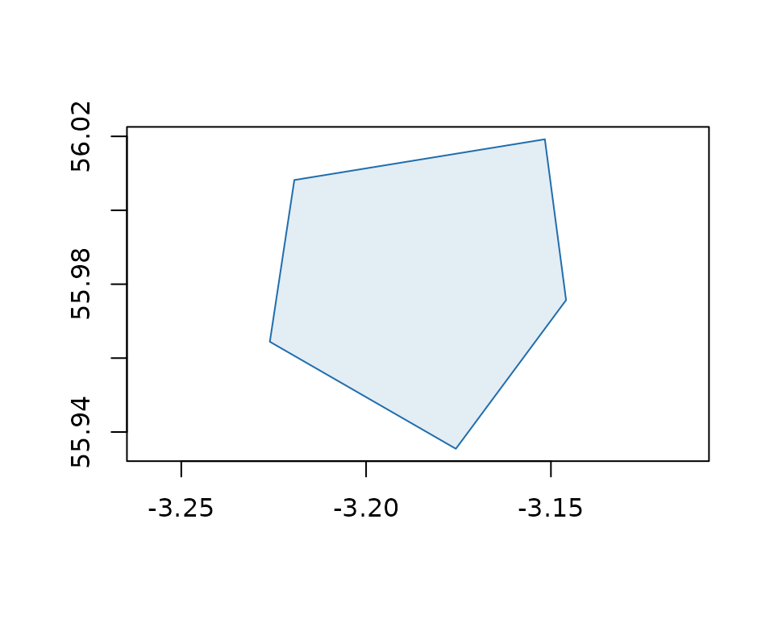
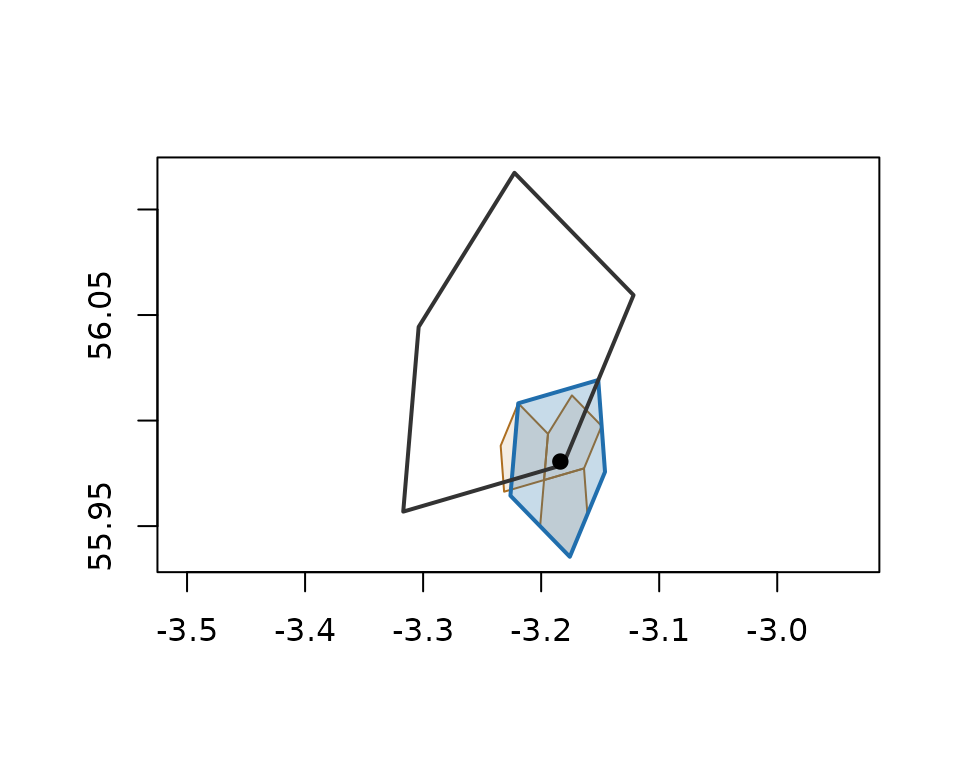
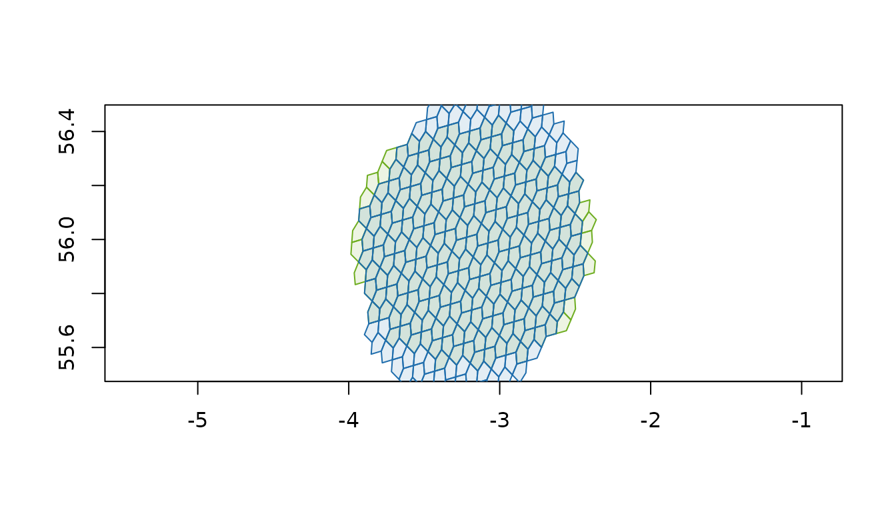
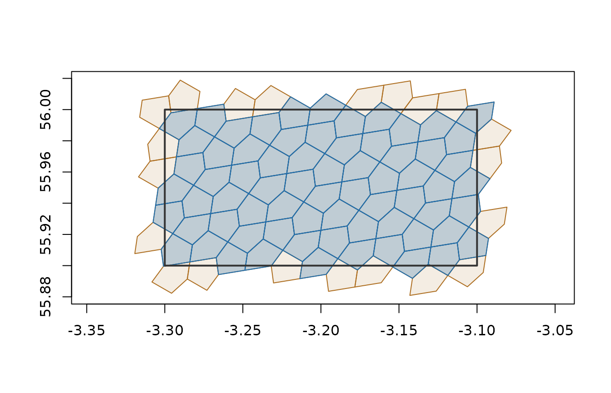
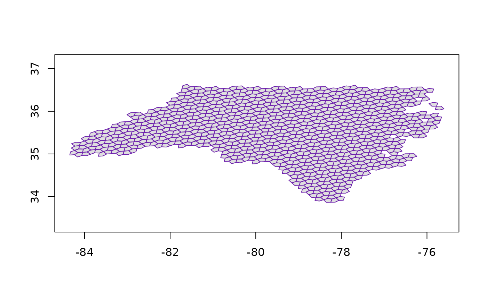
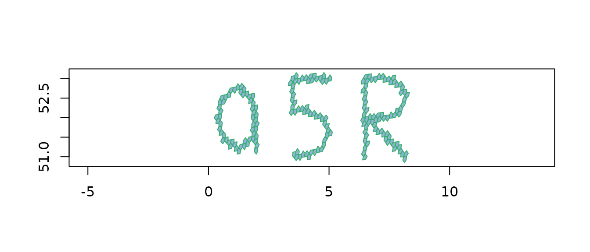

# Getting started with a5R

``` r

library(a5R)
#> a5R 0.9.9.9004 • a5 crate 1.0.0-beta.3 • A5 index 1.0 • 1 thread
```

## Index a point

Map a longitude/latitude coordinate to a cell at a given resolution
(0–30). Higher resolutions produce smaller cells.

``` r

cell <- a5_lonlat_to_cell(-3.19, 55.95, resolution = 10)
cell
#> <a5_cell[1]>
#> [1] 63bb948000000000
```

Convert back to the cell centre point:

``` r

a5_cell_to_lonlat(cell)
#> <wk_xy[1] with CRS=OGC:CRS84>
#> [1] (-3.183746 55.9806)
```

## Cell boundaries

Get the boundary polygon for one or more cells:

``` r

boundary <- a5_cell_to_boundary(cell)
boundary
#> <wk_wkb[1] with CRS=OGC:CRS84>
#> [1] <POLYGON ((-3.175718 55.93546, -3.145905 55.97569, -3.151641 56.01921, -3.219413 56.00818, -3.226037 55.96443, -3.175718 55.93546...>

plot(boundary, col = "#206ead20", border = "#206ead", asp = 1)
```



Boundaries are returned as `wk_wkb` vectors by default (set
`format = "wkt"` for WKT). Both integrate directly with sf, terra, and
other spatial tooling via the wk package.

## Hierarchy and compaction

A5 is a hierarchical grid: every cell has a **parent** at a coarser
resolution and 4 **children** at the next finer resolution.

``` r

parent <- a5_cell_to_parent(cell)
parent
#> <a5_cell[1]>
#> [1] 63bb960000000000

children <- a5_cell_to_children(cell)
children
#> <a5_cell[4]>
#> [1] 63bb942000000000 63bb946000000000 63bb94a000000000 63bb94e000000000
```

We can visualise the relationship: the parent (dark outline) contains
our cell (blue fill), which in turn contains its 4 children (orange):

``` r

plot(NULL, xlim = c(-3.23, -3),  ylim = c(55.98, 55.99),               
       xlab = "", ylab = "", asp = 1
       )
plot(a5_cell_to_boundary(a5_cell_to_children(cell)),
     col = "#ad6e2020", border = "#ad6e20", add = TRUE)
plot(a5_cell_to_boundary(cell), col = "#206ead40", border = "#206ead",
     lwd = 2, add = TRUE)
plot(a5_cell_to_boundary(parent), border = "#333333", lwd = 2, add = TRUE)
```



Cell area decreases geometrically: each level is roughly 4x smaller, so
the average edge length roughly halves per level.
[`a5_cell_edge_length_avg()`](https://belian-earth.github.io/a5R/dev/reference/a5_resolution_stats.md)
gives a quick sense of cell size when choosing a resolution.

``` r

a5_cell_area(0:5)
#> Units: [m^2]
#> [1] 4.250547e+13 8.501094e+12 2.125273e+12 5.313184e+11 1.328296e+11
#> [6] 3.320740e+10
a5_cell_edge_length_avg(0:5, units = "km")
#> Units: [km]
#> [1] 4649.1423 2343.3188 1190.1738  597.5652  299.1471  149.6100
```

### Compact and uncompact

[`a5_compact()`](https://belian-earth.github.io/a5R/dev/reference/a5_compaction.md)
stores a set of cells as an `a5_covering`: every complete group of
siblings is replaced by its parent, and the covering records the
resolution it stands for, so
[`a5_uncompact()`](https://belian-earth.github.io/a5R/dev/reference/a5_compaction.md)
needs no resolution to expand it again.

``` r

children
#> <a5_cell[4]>
#> [1] 63bb942000000000 63bb946000000000 63bb94a000000000 63bb94e000000000
covering <- a5_compact(children)
covering
#> <a5_covering[1]>
#> [1] res 11: 4 cells (1 stored)

# round-trips back to the original cells
a5_uncompact(covering)
#> <a5_cell[4]>
#> [1] 63bb942000000000 63bb946000000000 63bb94a000000000 63bb94e000000000
```

The polygon, disk and cap functions below also return coverings. Use
[`a5_uncompact()`](https://belian-earth.github.io/a5R/dev/reference/a5_compaction.md)
when you need the cells themselves.

## Traversal

Find neighbouring cells by hop count with
[`a5_grid_disk()`](https://belian-earth.github.io/a5R/dev/reference/a5_grid_disk.md),
or by great-circle distance with
[`a5_spherical_cap()`](https://belian-earth.github.io/a5R/dev/reference/a5_spherical_cap.md).
Both return one covering per centre cell:

``` r

disk <- a5_grid_disk(cell, k = 10)
cap <- a5_spherical_cap(cell, radius = 50000)
c(disk, cap)
#> <a5_covering[2]>
#> [1] res 10: 294 cells (69 stored) res 10: 239 cells (62 stored)

plot(a5_cell_to_boundary(a5_uncompact(cap)), col = "#6ead2020", border = "#6ead20", asp = 1)
plot(a5_cell_to_boundary(a5_uncompact(disk)), col = "#206ead20", border = "#206ead",
     asp = 1, add = TRUE)
```



## Converting geometries to a5 cells

[`a5_polygon_to_cells()`](https://belian-earth.github.io/a5R/dev/reference/a5_polygon_to_cells.md)
returns the cells whose centres lie inside a polygon. It accepts any
geometry that wk can handle (a
[`wk::rct()`](https://paleolimbot.github.io/wk/reference/rct.html)
bounding box, a WKT or WKB polygon, an `sf` / `sfc` feature) and also
terra `SpatVector` polygons.

``` r

covering <- a5_polygon_to_cells(wk::rct(-3.3, 55.9, -3.1, 56.0), resolution = 12)
covering
#> <a5_covering[1]>
#> [1] res 12: 69 cells (36 stored)

cells <- a5_uncompact(covering)
plot(a5_cell_to_boundary(cells), col = "#206ead20", border = "#206ead", asp = 1)
```


A covering stores far fewer cells than it stands for: whenever four
sibling cells all sit inside the polygon, they are stored as their
parent. Stored cells are index parents, whose outlines do not nest (see
[`vignette("spatial-hierarchy")`](https://belian-earth.github.io/a5R/dev/articles/spatial-hierarchy.md)),
so always uncompact before drawing.

By default only cells whose centre lies inside the polygon are returned,
so cells straddling the boundary are dropped and the union of the cells
does not fully cover the polygon. Pass `containment = "overlapping"` to
also keep every cell that touches the boundary, giving gap-free
coverage. The overlapping set is always a superset of the centre set.

``` r

overlapping <- a5_polygon_to_cells(wk::rct(-3.3, 55.9, -3.1, 56.0),
                                   resolution = 12, containment = "overlapping")
overlapping
#> <a5_covering[1]>
#> [1] res 12: 90 cells (36 stored)

plot(a5_cell_to_boundary(a5_uncompact(overlapping)),
     col = "#ad6e2020", border = "#ad6e20", asp = 1)
plot(a5_cell_to_boundary(cells),
     col = "#206ead40", border = "#206ead", add = TRUE)
plot(wk::rct(-3.3, 55.9, -3.1, 56.0), border = "#333333", lwd = 2, add = TRUE)
```



Each feature gets its own covering, so the result can be added to an
`sf` data frame as a column. A `MULTIPOLYGON` feature’s covering holds
the cells of all its parts, and a `POLYGON` with holes leaves the hole
cells out.

``` r

library(sf)
#> Linking to GEOS 3.12.1, GDAL 3.8.4, PROJ 9.4.0; sf_use_s2() is TRUE
demo(nc, ask = FALSE, echo = FALSE)
nc$cells <- a5_polygon_to_cells(nc, resolution = 9)
nc[1:3, c("NAME", "cells")]
#> Simple feature collection with 3 features and 2 fields
#> Attribute-geometry relationships: identity (1), NAs (1)
#> Geometry type: MULTIPOLYGON
#> Dimension:     XY
#> Bounding box:  xmin: -81.74107 ymin: 36.23388 xmax: -80.43531 ymax: 36.58965
#> Geodetic CRS:  NAD27
#>        NAME                       cells                           geom
#> 1      Ashe res 9: 11 cells (11 stored) MULTIPOLYGON (((-81.47276 3...
#> 2 Alleghany   res 9: 6 cells (6 stored) MULTIPOLYGON (((-81.23989 3...
#> 3     Surry res 9: 12 cells (12 stored) MULTIPOLYGON (((-80.45634 3...

plot(a5_cell_to_boundary(a5_uncompact(nc$cells)),
     col = "#03030320", border = "#6d20adff", asp = 1)
```



## Tracing a line

[`a5_linestring_to_cells()`](https://belian-earth.github.io/a5R/dev/reference/a5_linestring_to_cells.md)
returns the cells whose pentagons are crossed by a great-circle
polyline. Output is in discovery order along the path. Consecutive
waypoints are connected by great-circle arcs, so antimeridian-crossing
routes work transparently.

Each feature gives one path: a `MULTILINESTRING`’s parts are traced in
order into one path, each cell kept once. For several features,
`simplify = FALSE` returns one path per feature as an `a5_cell_list`;
the default concatenates them.

To show what cell-by-cell tracing looks like, we can write a short
phrase as a `MULTILINESTRING` (one stroke per letter) and ask A5 to fill
in the cells:

``` r

a5R_strokes <- wk::wkt(
  "MULTILINESTRING (
    (1.8 52.5, 1.2 52.8, 0.6 52.5, 0.4 52, 0.6 51.5, 1.2 51.2, 1.8 51.5, 2 52, 1.8 52.5, 2 51.2),
    (5 53, 3.5 53, 3.5 52.2, 4 52.2, 4.7 52, 5 51.6, 4.7 51.2, 4 51, 3.5 51.1),
    (6.5 51, 6.5 53, 7.5 53, 8 52.8, 8.2 52.5, 8 52.2, 7.5 52, 6.5 52, 8.2 51)
  )"
)

cells <- a5_linestring_to_cells(a5R_strokes, resolution = 9)
length(cells)
#> [1] 182

plot(a5_cell_to_boundary(cells),
     col = "#206ead80", border = "#37af6d", asp = 1)
```



Each stroke is one part of the `MULTILINESTRING`; the function walks
each great-circle path in turn and joins the strokes into one path, each
cell kept once.
